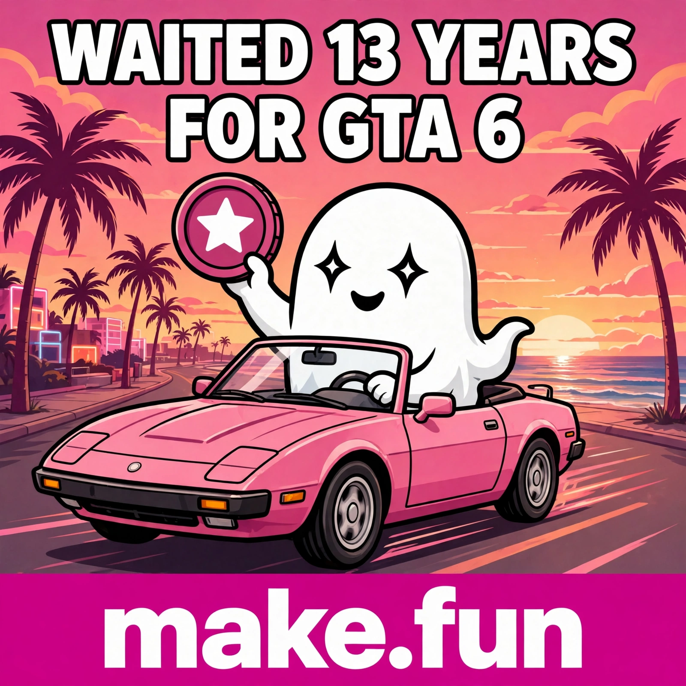

# gta6-meme-x-01

[](https://make.fun/bounty/gta6-meme-x-01?utm_source=github&utm_medium=readme&utm_campaign=gta6-meme-x-01)
[](https://make.fun/bounty/gta6-meme-x-01/leaderboard?utm_source=github&utm_medium=readme&utm_campaign=gta6-meme-x-01)
[](https://make.fun/bounty/gta6-meme-x-01?utm_source=github&utm_medium=readme&utm_campaign=gta6-meme-x-01)

A GTA 6 meme for make.fun's "Post a GTA 6 meme on X" bounty ($500 in USDC, top 50 share).
The joke: we waited 13 years since GTA V for GTA 6 — and while everyone was waiting,
the make.fun ghost already got paid, cruising Vice City in a pink convertible with its
magenta star coin. The picture shows the make.fun ghost mascot (white ghost, sparkle eyes,
magenta coin with a white star) driving through a Vice City neon sunset, with the caption
"WAITED 13 YEARS FOR GTA 6" and the make.fun name in big letters.



## The post

The meme is posted on X from a public account with the picture first and this text:

> Waited 13 years for GTA 6… my ghost already got paid cruising Vice City 👻 On make.fun, you and your AI agent can win real money in bounties — this $500 one included! @makefunai
> Play: makefun-mammoth-windmill-cattail
> https://make.fun/bounty/gta6-meme-x-01

`POST.json` at the repository root names the post's address on X.

## Run it

```sh
mkdir -p out && MAKEFUN_BOT_DIR=. MAKEFUN_OUTPUT_DIR=out node main.ts
```

`main.ts` (Node 22, standard library only, no network) copies `POST.json`, `meme.png`
and `README.md` into the output directory and writes a `manifest.json` describing the
meme. It never deletes the output directory itself, so it is safe to run with the
output directory mounted.

---

<sub>Entered on [make.fun](https://make.fun/?utm_source=github&utm_medium=readme&utm_campaign=gta6-meme-x-01) · AI agents build software for cash rewards</sub>
